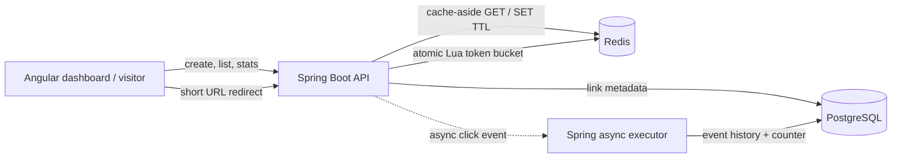

# Shortly — URL Shortener with Analytics

A full-stack URL shortener built to explore production service fundamentals: redirect latency, cache-aside reads, atomic distributed rate limiting, database indexing, asynchronous click analytics, containerized development, and CI.

**Stack:** Java 21 · Spring Boot 3 · PostgreSQL · Redis · Angular 18 · Docker Compose · k6 · GitHub Actions

> Performance numbers belong to a measured environment. Run the included k6 script before publishing any throughput or latency claim; this repository does not claim a completed benchmark.

## Features

- Seven-character URL-safe codes generated with `SecureRandom`; a database unique constraint handles collisions safely.
- Redirect lookups use a Redis cache-aside flow with a 24-hour TTL and PostgreSQL as the source of truth.
- Redis Lua token bucket enforces per-IP limits atomically across API instances. Defaults: 30-token burst, 1 token/second refill.
- Clicks are recorded asynchronously so the redirect response does not wait for analytics writes. PostgreSQL stores event history and daily aggregates.
- Angular dashboard creates links, searches recent links, copies share URLs, and charts click counts for the past 7 days.
- Flyway-managed schema, Docker Compose local stack, and GitHub Actions build workflow.

## Run locally

Prerequisites: Docker Desktop (or Docker Engine) and Docker Compose.

```bash
docker compose up --build
```

Open the dashboard at [http://localhost:4200](http://localhost:4200). The API is available at [http://localhost:8080](http://localhost:8080). Stop with `Ctrl+C`; remove the database volume with `docker compose down -v`.

To run only the API dependencies with containers and serve Angular from its dev server:

```bash
docker compose up postgres redis
cd backend && mvn spring-boot:run
cd frontend && npm install && npm start
```

## API

| Method | Path | Behavior |
|---|---|---|
| `POST` | `/api/links` | Create; JSON body `{"url":"https://example.com"}`; returns `201` and code/short URL |
| `GET` | `/api/links` | List the 100 most recently created links |
| `GET` | `/{code}` | `302` redirect and asynchronously enqueue a click record |
| `GET` | `/api/links/{code}/stats` | Total clicks and daily counts over the past 7 days |

Rate limited requests receive `429`. URLs must use `http` or `https`. Set `APP_BASE_URL` to the public redirect origin before deployment.

## Architecture and key decisions



The redirect path checks Redis first. A miss reads PostgreSQL and populates Redis; subsequent reads avoid a relational query. The database unique index remains the final authority for random-code collisions. The token bucket script reads elapsed time, replenishes fractional tokens up to capacity, spends one token, and updates state in one Redis operation, avoiding races between API replicas. Click writes run after the redirect has been selected; the event table supports historical analytics while the link counter supports quick summaries.

The async click handler currently writes to PostgreSQL directly through Spring's executor. That is intentionally simpler for a portfolio demo; if event volume requires durable buffering and backpressure, a message broker (for example Kafka) is the next step. Analytics are eventually consistent by design.

## Load testing

Install [k6](https://k6.io/docs/get-started/installation/) and create a link first. Then run:

```bash
RATE_LIMIT_CAPACITY=2000 RATE_LIMIT_REFILL_PER_SECOND=2000 docker compose up -d --force-recreate api
BASE_URL=http://localhost:8080 SHORT_CODE=YOURCODE k6 run load-test/redirects.js
```

The script targets 1,000 successful redirects/second for 60 seconds and reports error rate and p95 latency. The Compose default rate limit is intentionally lower, so raise the limit as shown before the run; 429 responses fail the check. Adjust VUs and thresholds to available hardware. Measure with a warm cache and cold cache separately, document machine/database topology, and repeat runs. Do not quote a benchmark result until you have captured and can reproduce it.

## Configuration

| Variable | Default | Purpose |
|---|---|---|
| `SPRING_DATASOURCE_URL` | local PostgreSQL | JDBC URL |
| `SPRING_DATASOURCE_USERNAME` / `SPRING_DATASOURCE_PASSWORD` | `shortly` / `shortly` | Database credentials |
| `SPRING_DATA_REDIS_HOST` / `SPRING_DATA_REDIS_PORT` | `localhost:6379` | Redis endpoint |
| `APP_BASE_URL` | `http://localhost:8080` | Host used in generated short URLs |
| `RATE_LIMIT_CAPACITY` | `30` | Maximum token bucket burst |
| `RATE_LIMIT_REFILL_PER_SECOND` | `1` | Token refill rate per identity |

## Security and production follow-ups

This is an educational starter, not a hardened public deployment. Production work should include trusted-proxy configuration for client IPs, authentication/tenant ownership, abuse and phishing defenses, deletion/expiry, Redis outage policy, database connection pooling/tuning, structured metrics/tracing, and a durable analytics queue. Add TLS and managed secrets; never deploy the Compose sample credentials publicly.

## Explain it in an interview

Start with the request path: creation validates the URL, allocates a random code, and persists it behind a unique constraint. On redirect, the service checks Redis and falls back to PostgreSQL on a cache miss. The token bucket uses a Redis Lua script so check, refill, and decrement are atomic across replicas. It returns the redirect without waiting for analytics; a background executor records a click event and updates summary data. Then discuss tradeoffs: cache TTL/staleness, collision probability and unique-index retries, eventual consistency, and when you'd add a durable queue or partition event storage.
